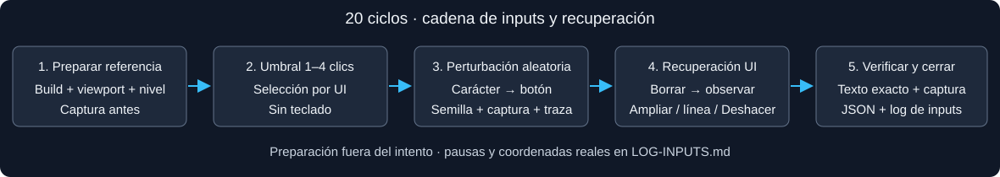

# War · segunda tanda ampliada · 30 de octubre de 2026

Verificación de las correcciones del editor sin teclado en localhost:8771. La tabla completa se genera en [RESULTADOS.md](RESULTADOS.md); [LOG-INPUTS.md](LOG-INPUTS.md) contiene los inputs de los veinte ciclos y enlaces a capturas y JSON.

## Resultado actual y prioridades

**20/20 recuperaciones exactas, sin teclado**, con build actual verificada: juego v13, estructura v2 y editor v14. Tres recuperaciones con un solo Borrar (11, 12, 20), otras dos terminando con borrado de línea (14, 15), y quince con Deshacer de la perturbación. En 14/15 se deshizo primero un ensayo local fallido. 56 clics de reparación contados dentro del área del arnés; los dos cierres de sugerencias están fuera de esa área y añaden dos inputs reales. Sin errores JS registrados dentro de los intentos.

| Prioridad | Hallazgo | Frecuencia observada | Resultado / recuperación |
| --- | --- | --- | --- |
| P2 | **WAR-20-UI-01: la hoja móvil tapa el asa de línea. Fricción confirmada** | Un bloqueo efectivo en 20 ciclos (14); reproducción dirigida filmada aparte | La opción de la lista intercepta el punto de la línea 5. Cerrar sugerencias → elegir línea → Borrar recupera el texto. No hubo pérdida de programa. |
| P3 | **Desenvolver sigue siendo una carencia útil de revisar** | Cinco envolturas de control sorteadas (5, 7, 13, 16, 17), más otras envolturas de llamada | Borrar el contenido conserva la envoltura; Deshacer fue la salida rápida usada. Esta tanda no demuestra que no exista otra reparación manual. |
| — | Regresiones anteriores verificadas | 87 lógica + 66 navegador, y controles filmados de selección | Las correcciones cubiertas pasan; no se confirma un nuevo bug de pérdida de texto. No equivale a ausencia de fallos en todos los gestos. |

### WAR-20-UI-01 · cadena de regresión

393×852, herramientas y coordenadas abiertas, R4 más `console.warn(/* mensaje */);` en la línea 5. Seleccionar `/* mensaje */` abre la hoja de sugerencias desde aproximadamente y=691 hasta el pie del editor. El asa de línea 5 está alrededor de (31.8, 790). `elementFromPoint` devuelve un elemento de la opción, no el número de línea. El intento de `page.click` sobre el asa falló por interceptación de `<code>`; no se usó clic forzado.

**Secuencia:** tocar mensaje → lista sobre asa → intento de elegir línea bloqueado → cerrar con × → tocar número 5 → Borrar → comparación exacta positiva. [Captura del bloqueo](evidencia/14-bloqueo-linea.png), [JSON completo](evidencia/14-traza.json), [cierre del arnés](evidencia/caso-14.json). El tiempo de 46,1 s incluye diagnóstico y reanudación tras el fallo de automatización. La hoja cabe en pantalla: este hallazgo no reabre ED-04 («fuera de pantalla»).

## Protocolo

20 ciclos: R1–R5 dos veces en PC (1366×900), y dos veces en móvil emulado (393×852). Niveles seleccionados: 1, 3, 4, 4, 5, 4, 4, 4, 4, 5 por formato: **12/20 en nivel 4**. Son fixtures de edición, no estrategias ganadoras ni veinte partidas de simulación. Se preservan versión, viewport, selección, texto completo y coordenadas en los JSON.

Semilla `war-postfix-20-20261030-v1`, RNG independiente de la simulación. Umbral 1–4 clics de selección sobre la primera ficha; después el arnés sortea un carácter visible y pulsable y un botón permitido. La paleta desplazable permite botones fuera de su franja inicial; Ego los lleva a la vista antes del clic. La muestra no representa clics uniformes sobre toda la pantalla.

Por intento: captura antes → perturbación → ensayo de Borrar sobre la selección dejada por la inserción → observar → recuperar el ensayo con Deshacer si cambió el texto sin restaurarlo → Deshacer la perturbación. En el segundo bloque se añadió un ensayo por asa de línea si el diff indicaba una sola línea insertada. Este protocolo rápido evalúa la reversibilidad y los obstáculos de un ensayo local; no busca el mínimo de clics ni agota todas las estrategias manuales posibles. Presupuesto máximo 40 clics / 180 s. Solo UI durante intentos, preparación con fill antes de iniciar.

## Verificación dirigida

**87 comprobaciones de lógica y 66 de navegador War correctas**, ejecutadas en esta misión. Las regresiones de navegador incluyen selección pendiente, operandos lógicos, partes obligatorias al borrar, cursor después de borrar y geometría/sugerencias en móvil. Esta suite combina fixtures preparados mediante APIs y gestos reales; se distingue de los intentos de recuperación solo UI.

Las películas de selección rápida/pausada y la fricción de sugerencias están enlazadas en [VIDEOS.md](VIDEOS.md): el JSON mide los inputs reales y conserva estados y metadatos. El HUD QA ocupa la franja superior, los MP4 no tienen audio y la salida a 30 fps duplica frames según los intervalos de captura. Las tomas muestran una regresión dirigida, no la filmación de todos los ciclos. Los tres MP4 se decodificaron completos y se revisaron mediante hojas de cuatro fotogramas.

## Incidencia de infraestructura durante la tanda

La primera ejecución cargó la build actual en PC y HTML antiguo en móvil. La inspección de los scripts y de `cmg.envolver.toString()` confirmó juego v12/editor v13 con cuatro espacios, frente a juego v13/editor v14 con dos espacios tras desactivar caché y recargar. Se conserva completa en [la tanda de caché mixta](../war-20-ciclos-2026-10-30-cache-mixta/LEEME.md), excluida de los resultados actuales.

Se repitieron los veinte ciclos desactivando caché y verificando versión antes de iniciar cada uno. Este incidente explica la reaparición aparente de defectos corregidos; no se atribuye al dominio publicado. La protección queda en `pruebas/war-20-ciclos.mjs`.

## Reproducción y límites

Usar los mismos recursos (hashes en [MANIFIESTO.json](MANIFIESTO.json)), origen, fixture, modo, viewport, selección y desplazamiento del JSON. Preparar fuera de un intento. Repetir las coordenadas y botones de la traza, respetando los tiempos; semilla sola no reconstruye decisiones de reparación ni geometría. El adaptador externo es `pruebas/war-20-ciclos.mjs`; `tanda(page,1,20)` usa un directorio fijo y debe adaptarse a uno nuevo antes de otra ejecución.

Chromium con ratón y móvil emulado; no valida Android/iOS ni tacto real. Tokens no medidos. No se modificaron recursos del juego. El grabador externo admite elegir carpeta de salida para conservar las películas históricas. Sin commits ni publicación.
