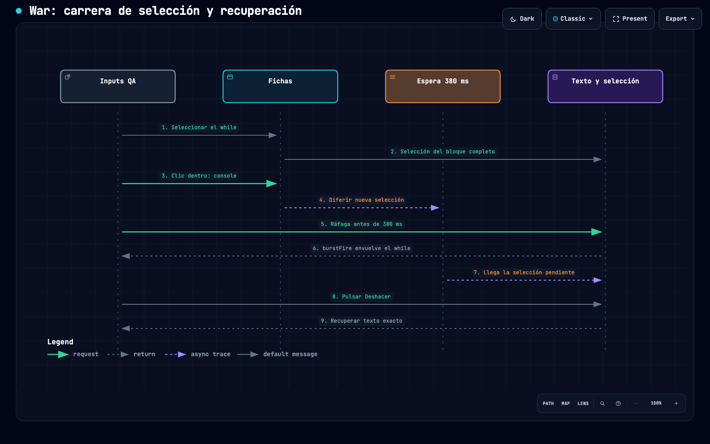

# War · QA de recuperación con clics aleatorios · 29-oct-2026

Diez ciclos, seis sobre el nivel 4, cinco PC y cinco móvil emulado. Diez recuperaciones exactas del texto. Sin correcciones al juego. [Log secuencial íntegro por ciclo](LOG-INPUTS.md), [resumen verificable](evidencia/resumen.json) y [vídeos posteriores](../war-2026-10-30/VIDEOS.md).

## Prioridades

| Prioridad | Caso | Evidencia y resultado |
| --- | --- | --- |
| P1 | WAR-SEL-01: selección pendiente | Evidencia clara en ciclos 4–10; 2/2 reproducciones rápidas dirigidas, 0/1 control con pausa de 450 ms. Bug confirmado en esta build. |
| P2 | WAR-EDIT-02: restos al borrar | Tres reparaciones locales dejan `??`, `const =` o `;`. Fricción, no contrato de Borrar incumplido demostrado. |
| P2 | WAR-VIEW-03: espacio móvil | Herramientas abiertas y coordenadas visibles dejan pocas líneas; depende de preferencias. No se demuestra bloqueo permanente. |

## Cadena y reproducción

[Diagrama interactivo](cadena-inputs.html). Seleccionar while → clic dentro de console → Ráfaga antes de 380 ms → se envuelve el bloque anterior → selección pendiente llega tarde → Deshacer recupera el texto exacto. En el ciclo 4 el intervalo fue 204 ms. El código `toque` de shared/js/edicion.js difiere el clic interno 380 ms para distinguir doble clic. El control con pausa de 450 ms usa la ficha nueva; no promete que la inserción arbitraria sea un programa válido.

Preparar `objetivo.codigo` de [caso 4](evidencia/caso-04.json), JavaScript sin teclado, 1366×900, origen 8771. Seleccionar while y estabilizarlo; pulsar console y Ráfaga rápidamente. Comparar con la misma preparación y pausa de 450 ms tras console. Deshacer una vez permite continuar. El módulo `pruebas/war-recuperacion-regresion.mjs` expone `diagnosticarSeleccion`. El reproductor `reproducirCaso` exige reconstruir código, selección, modo, viewport y scroll: la semilla sola no reconstruye decisiones ni tiempos del agente.

## Recuperación y límites

Ciclos 1–3: Borrar el hueco deja ??; Borrar pos deja const =; Ampliar una vez y borrar stopFire() deja ; residual. Dos Deshacer recuperan borrado e inserción. Ciclos 4–10: un Deshacer. Veinte clics de recuperación, trece de Deshacer; no se usó teclado durante la recuperación. Los fixtures se prepararon entre intentos cerrados.

Semilla de perturbación war-niveles-20261029-v1; 40 clics/180 s por ciclo. Sorteo entre caracteres visibles y botones permitidos, no toda la pantalla. La selección inicial de la primera ficha pulsada 1–4 veces puede abarcar el bloque entero: la frecuencia no es extrapolable a jugadores. Los primeros tres ciclos preceden al ajuste del arnés para observar tras dos fotogramas. Todos conservan trazas y tres capturas en el log.

Las seis ejecuciones del programa inicial del nivel 4 con semilla 17 dieron 33 derribos, 2 brechas, 4 atascos a 49,2 s. La pista indica que el programa necesita ajustes; no se buscó una estrategia ganadora. El programa de LAU-02 no se normalizó en el ciclo del nivel 5; ese resultado no prueba dificultad del reto.

Verificación de esta tanda: 75 checks de lógica y 57 de navegador de War correctos. Móvil emulado con ratón; no valida tacto real. Preferencias previas del origen conservadas. No se midieron tokens/coste. Esta tanda por niveles no sustituye la matriz R1–R5 del piloto original. Hashes en evidencia/version-sha256.json. Diagrama: 9/9 controles showcase, evidencia de navegador y revisión visual; recibos en evidencia. Sin commits, push ni publicación.
